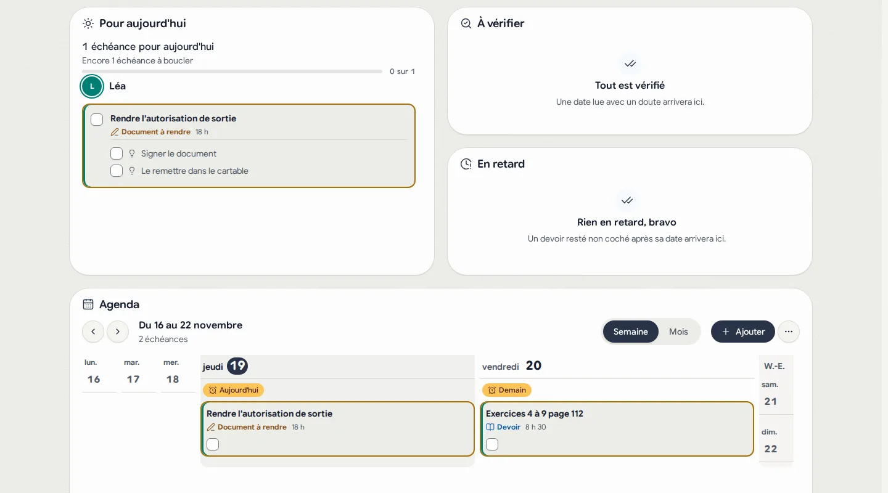
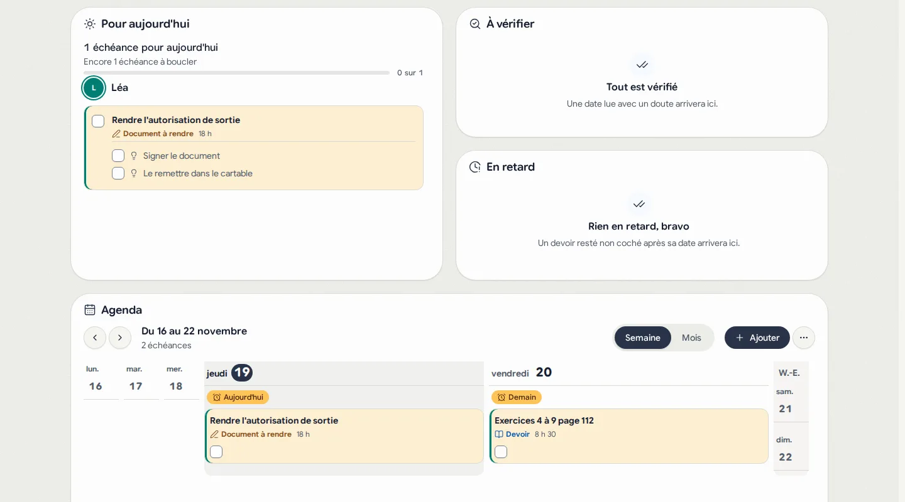
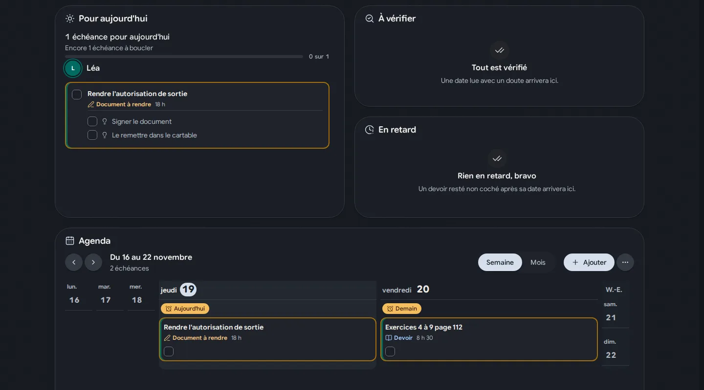
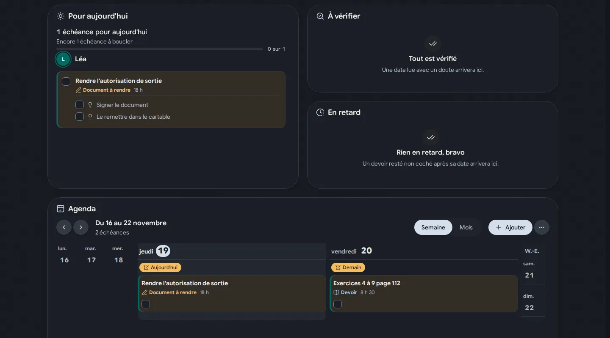
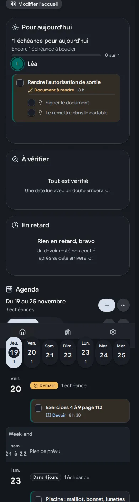

# Visual system audit

Findings on the rendered app that the scale guards did not catch, each with its decision and the guard that now holds it.

## A deadline card had two signals on one edge

**Seen** (develop after #58): a deadline due today or tomorrow, in a one child family, drew a 2px amber contour around the whole card while the child's teal stripe ran inside it on the leading side. The leading corner turned two-coloured and its two radii did not meet (the stripe followed the inner radius of a 2px border). The amber said nothing new: the "Aujourd'hui" or "Demain" badge already says it, and a late card did the same in red beside its "En retard" badge.

**Decision: one edge, one role.**

- The child's stripe is the only coloured edge: `shadow-stripe`, a 3px inset shadow on the leading side that follows the card's corner, never a `border-left`.
- Urgency and lateness leave the contour. They are the badge, plus a breath of its colour on the paper: `bg-paper-urgent` and `bg-paper-overdue`, tokens in `globals.css`, light amber or red on the card in light, dark amber or red on the paper in dark.
- The card's border is the system's neutral 1px hairline.
- `deadlineSurface(family, state)` picks the paper of every deadline card (home blocks, agenda board and thread, overdue list, review lines, onboarding). A family of two children keeps its tints: there the fill names the child, and the urgency is the badge alone.

**Why**: two signals on the same edge read as a bug, not as two pieces of information.

**Contrast**: `palette-contrast.test.ts` reads both papers from the tokens and holds the ink, the muted ink, every category word (4.5:1), the checkbox edge and the focus ring (3:1) on them, in every palette, light and dark. The dark amber stops at 25%, the most the checkbox edge allows.

**Guard**: `apps/app/a11y/deadline-edge.spec.ts`, on the home with a card due today, tomorrow, late and later, for one and two children, at 390 and 1440px, light and dark: no deadline card draws a coloured contour beside the child's stripe. It failed on develop on all 4 one child cases before the change.

| | Before | After |
|---|---|---|
| 1440 light |  |  |
| 1440 dark |  |  |
| 390 light |  |  |
| 390 dark |  |  |
